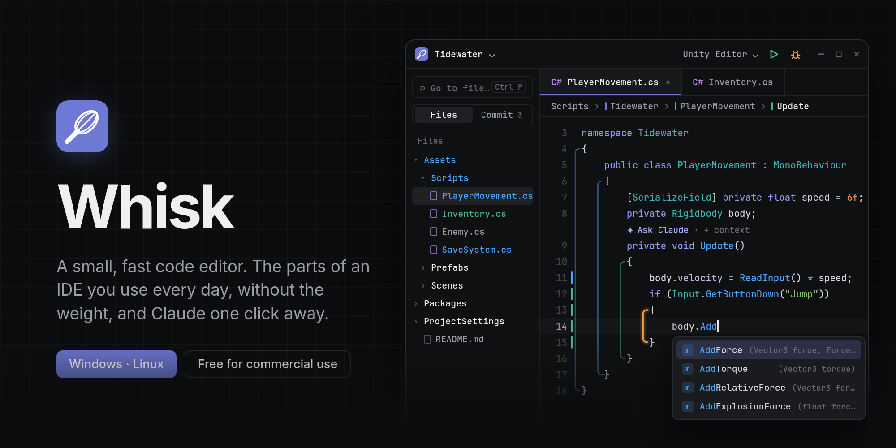

<p align="center">
  
</p>

<p align="center">
  <a href="https://github.com/CookieJarTools/Whisk/releases/latest"><b>Download</b></a> ·
  <a href="#whats-in-it">What's in it</a> ·
  <a href="#unity">Unity</a> ·
  <a href="#claude">Claude</a> ·
  <a href="#shortcuts">Shortcuts</a>
</p>

Whisk is a code editor with the parts of a big IDE you actually use every day: suggestions, go to definition, find usages, search everywhere, git, a terminal, and running, testing and debugging. It starts fast and stays out of the way. Everything is monospace, and Claude is one click away from any method or class.

It's free, including for commercial work, and it keeps itself up to date.

## Install

Get the latest version from the [Releases page](https://github.com/CookieJarTools/Whisk/releases/latest).

### Windows

Download `Whisk_x.y.z_x64-setup.exe` and run it. It installs just for you, so it won't ask for admin rights.

<details>
<summary>Windows says Whisk isn't safe</summary>

Whisk isn't code-signed yet, so Windows may be cautious about it:

- **SmartScreen** may say "Windows protected your PC". Click **More info**, then **Run anyway**.
- **Microsoft Defender** has wrongly flagged Whisk as a trojan before and removed it. If that happens, open **Windows Security › Virus & threat protection › Protection history**, find the Whisk entry and choose **Allow on device**.

Only do this for a file you downloaded from this repo's [Releases page](https://github.com/CookieJarTools/Whisk/releases). Each release is built by GitHub Actions straight from the code here, and you can see the build log for every one. Signed releases are on the way.

</details>

### Linux

Download `Whisk_x.y.z_amd64.AppImage`, put it somewhere it can stay and run it:

```bash
mkdir -p ~/Applications
mv ~/Downloads/Whisk_*_amd64.AppImage ~/Applications/Whisk.AppImage
chmod +x ~/Applications/Whisk.AppImage
~/Applications/Whisk.AppImage
```

Updates replace the AppImage where it is, so you only do this once. If you'd rather use a package, the release also has a `.deb` and an `.rpm`, which update themselves the same way.

Whisk runs on Arch, Fedora 40, Debian 13, Ubuntu 24.04 and anything newer.

<details>
<summary>Add Whisk to your app launcher</summary>

```bash
mkdir -p ~/.local/share/applications
cat > ~/.local/share/applications/whisk.desktop <<EOF
[Desktop Entry]
Type=Application
Name=Whisk
Comment=A small, fast code editor
Exec=$HOME/Applications/Whisk.AppImage %F
Categories=Development;IDE;
EOF
```

</details>

<details>
<summary>It won't start, or opens to a blank window</summary>

- AppImages need FUSE 2: `sudo pacman -S fuse2` on Arch, `sudo apt install libfuse2t64` on Ubuntu.
- Some NVIDIA drivers can't draw the window. Start Whisk with `WEBKIT_DISABLE_DMABUF_RENDERER=1 ~/Applications/Whisk.AppImage`, and put the same in front of `Exec=` if you use the launcher entry above.

</details>

## What's in it

**Scope rails.** Every block of code gets a coloured line down its left side, so you can see where it starts and ends. The block your cursor is in lights up, and the ones around it fade back. The bar above the editor shows the namespace › class › method you're in, in the same colours.

**Suggestions, errors and quick fixes.** Completion, hover docs, errors, go to definition, find usages and rename come from [language servers](#language-servers), which Whisk installs for you. Press Alt+Enter on a problem for fixes and refactorings, like adding a missing `using` or extracting a method.

**Search like Rider.** Tap Shift twice to search types, files, methods, actions and text across the whole project, with a preview as you type.

**Git.** Marks in the gutter show what changed since the last commit; click one to see what was there or roll it back. Turn on blame to see who changed each line. The **Commit** view lists your changes with a checkbox each, so you can commit just some of them, then push. Pull, push and switching branches are on the branch in the status bar.

**Terminal.** A real terminal under the editor (Alt+F12), with as many tabs as you like.

**Run, test and debug.** Run your app, run your tests as a tree of results, and debug with breakpoints, variables and the call stack. [More below](#run-test-and-debug).

**Your shortcuts.** Pick the Whisk, Rider, VS Code or Visual Studio keymap, then change any shortcut. Whisk warns you if a key is already taken.

**Picks up where you left off.** Each project reopens with the tabs you had and the cursor where you left it. Files save themselves when you switch away and after 15 seconds without typing, as in Rider.

**And the rest.** Fold any block, with the class and method you're in pinned at the top as you scroll. Split view, and side-by-side diffs with the clipboard or another file. Markdown with a live preview. New projects for C#, React + Vite, Node + TypeScript, Rust, Python and Go. A compact layout that hides the title bar and explorer until you reach for them.

## Unity

Open a Unity project in Whisk and click **Set up Unity** in the bar that appears. That's all:

- Whisk becomes Unity's script editor. Double-click a script or a console error in Unity and it opens in Whisk at that line, in the window you already have open.
- C# suggestions, errors and go to definition work across all your assemblies.
- To debug, pick **Unity Editor** in the box at the top and press the bug button while the project is open in Unity. Whisk switches Unity to Debug mode for the session and attaches. Set breakpoints, press Play, and Whisk stops on them. Stop detaches and leaves Unity running.

Set-up adds a small package to the project (`Packages/com.cookiejar.ide.whisk`). Commit it and your team gets the same set-up. Unity's script editor choice is per computer, so each person picks Whisk once: the bar in Whisk does it for them, or **Preferences › External Tools** in Unity.

On Linux, Unity finds Whisk wherever you keep the AppImage, once you've opened Whisk at least once. Debugging Unity on Linux also needs Mono (the `mono` package on Arch).

Debugging works in the editor, which always uses Mono. Built players and IL2CPP builds can't be debugged from Whisk yet, and Unity's own tests run in Unity's Test Runner rather than in Whisk.

## Claude

Above each method and class there's a small row of links:

- **✦ Ask Claude** sends that code to Claude, ready for your question.
- **+ context** also sends the rest of the class it lives in and the project types it uses, so Claude has the full picture.

The same options are in the right-click menu, and Ctrl+Alt+A asks about the code at the cursor. By default they open the Claude desktop app with your code filled in. To use Claude Code in a terminal instead, change it in **Settings › Claude**.

## Run, test and debug

**Running.** Pick what to run from the box at the top right and press ▶. Whisk finds the usual things on its own: .NET apps, the scripts in `package.json`, `cargo run`, `go run .` and Python entry points. **Current file** runs whatever file is open. Output appears in the **Run** tab at the bottom.

To add your own, or change one Whisk found, choose **Edit configurations…** from the same box. They're saved in `.whisk/run.json`, so you can commit them for your team:

```json
{
  "configurations": [
    { "name": "Server", "command": "npm run dev", "cwd": "web", "env": { "PORT": "3000" } }
  ]
}
```

**Tests.** The **Tests** tab runs your tests and shows the results as a tree: .NET (xUnit, NUnit, MSTest), Vitest, Jest, pytest, `cargo test` and `go test`. Click a failed test to see why; double-click to open it. **▶ Run test** appears above each test method and test class.

**Debugging.** Click left of the line numbers to set a breakpoint (right-click it to add a condition), then press the bug button. When the program stops you get the call stack, the variables, values when you hover over code, and a console to evaluate expressions.

Debuggers for **C#**, **Python** and **C, C++ and Rust** are built in; install them with one click in **Settings › Debuggers**. On Linux, `lldb-dap` (for C, C++ and Rust) comes from your package manager: it's in the `lldb` package on Arch. For any other language, click **Add your own** there and enter any debugger that speaks the Debug Adapter Protocol.

## Language servers

Language servers give Whisk its suggestions, errors and navigation. Open **Settings › Language servers** to see the list; most install with one click. If one needs something first, like Node.js or the .NET SDK, Whisk tells you and links to it.

Built in: C#, TypeScript and JavaScript, Rust, Python, Go, C and C++, Lua, Bash, YAML, JSON, CSS, HTML, TOML, PHP, Ruby, Svelte, Dockerfile, Dart, Java, Kotlin, Zig and Markdown. For anything else, click **Add your own** and enter the server's command; any server that speaks LSP works.

For C#, open the folder that contains your `.sln` file. On Linux, servers from npm install into `~/.local`, so they don't need root, and clangd and LuaLS come from your package manager (`clang` and `lua-language-server` on Arch).

## Checking your code

Whisk underlines problems as you type: compiler errors from the language server, plus its own simple checks for any language, like trailing spaces, methods that are too long or nest too deep, and empty `catch` blocks. The count is in the status bar, and F8 jumps to the next one.

Turn checks on or off, change their limits or add your own in **Settings › Linter**, and share them with your team in `.whisk/lint.json`. [All the checks and the file format](docs/checks.md).

## Shortcuts

These are the defaults in the Whisk keymap. Change any of them in **Settings › Keymap**, or switch to the Rider, VS Code or Visual Studio keymap.

| Shortcut | Does |
|---|---|
| Shift Shift | Search everywhere |
| Ctrl+Shift+F | Find in files |
| Ctrl+P | Go to file |
| Ctrl+N | Go to type |
| Ctrl+F12 | File structure |
| Ctrl+F / Ctrl+R | Find / replace in this file |
| F12 or Ctrl+Click | Go to definition |
| Shift+F12 | Find usages |
| F2 | Rename |
| Ctrl+Alt+Left / Right | Back / forward |
| Ctrl+E | Recent files |
| Ctrl+G | Go to line |
| Ctrl+Shift+A | Find any action |
| Ctrl+, | Settings |
| Ctrl+Alt+C | Compact mode |
| Ctrl+Alt+S | Show / hide the explorer |
| Alt+Enter | Quick fixes and refactorings |
| Ctrl+Alt+L | Reformat file |
| F8 / Shift+F8 | Next / previous problem (step over / out while debugging) |
| Ctrl+\ | Move the tab to the other side (split) |
| Alt+F12 or Ctrl+` | Terminal |
| Ctrl+K / Ctrl+Shift+K | Commit / push |
| Shift+F10 / Shift+F9 / Ctrl+F2 | Run / debug / stop |
| Ctrl+F8 | Toggle breakpoint |
| F9 / F7 | Resume / step into (while debugging) |
| Ctrl+Alt+A | Ask Claude about the code at the cursor |

## Updates

Whisk checks for new versions every few hours and downloads them in the background. When one is ready, a **Restart to update** button appears in the status bar. Nothing restarts without you.

In **Settings › Updates** you can check now, turn automatic updates off, opt in to pre-releases, or go back to any earlier version if a new one gives you trouble. Updates are signed, and Whisk won't install one that doesn't match.

## Plugins

Plugins can add links above methods and classes, entries in the right-click menu, and commands with their own shortcuts. Click the plugin count in the status bar to open the plugins folder. [How to write one](docs/plugins.md).

## Contributing

Bug reports and ideas are welcome in [Issues](https://github.com/CookieJarTools/Whisk/issues). To build Whisk yourself or find your way around the code, see [CONTRIBUTING.md](CONTRIBUTING.md).

## License

[PolyForm Shield 1.0.0](LICENSE.md). Use Whisk for anything you like, including commercial work; just don't use it to build a competing editor.

Whisk includes the [Unity debug adapter](https://github.com/walcht/unity-dap) by Walid Chtioui (MIT License), built from source when Whisk is built. Its licence is installed next to it.
